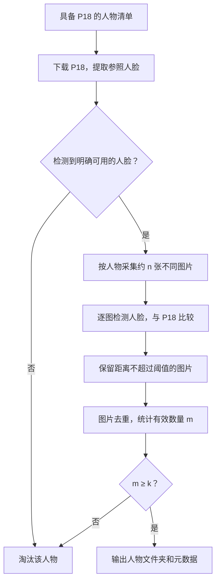

# 基于 Wikidata P18 的人物身份图片数据集建设方案

日期：2026-10-10  
状态：工程设计；本文定义数据采集与清洗方法，尚未执行采集或开发。

## 1. 建设目标

建设一套可靠、可追溯的“人名—相貌图片”数据集，使视觉语言模型能够从图片中的人物形象识别其身份。每个人拥有一个独立文件夹，文件夹中的图片均与该人物的标准参照图通过人脸比对。

人物来自 Wikidata，参照图来自该人物条目的 P18 属性。先为每个人采集约 10～100 张不同图片，再通过人脸检测、身份特征比较、图片去重和最低数量筛选，得到最终数据集。

**有效图片可以是照片、油画、素描、版画、雕像等，只要其中的人脸能够检测并与参照匹配。** 例如，拿破仑的 P18 是一幅画像，其他画像中的面部形象能够与之匹配，这些画像就可以组成拿破仑的有效图片组。这里学习的是人物在图像中的可辨认形象；历史画像不需要被解释为对其生物相貌的精确记录。

最终交付包含有效图片、人物姓名与别名、Wikidata 身份编号、P18 参照、来源信息和每张图片的清洗结果。数据使用者可以直接读取“某个人对应哪些图片”，也可以回查每张图片为什么被保留。

## 2. 基本概念与处理规则

| 概念 | 含义 |
| --- | --- |
| Wikidata | 以结构化条目记录人物、地点、作品等实体的知识库 |
| QID | Wikidata 条目的唯一编号，如 `Q…`；本数据集用它标识人物、命名文件夹 |
| P18 | Wikidata 的“图像”属性；人物条目通过它关联一张或多张图片 |
| 参照图 | 为一个人物选定并固定的 P18 图片，用于后续所有人脸比对 |
| 候选图片 | 围绕该人物采集、尚未通过清洗的图片 |
| 有效图片 | 人脸比对通过，且经过图片去重后保留的候选图片 |
| `n` | 每个人计划采集的不同候选图片数，通常配置在 10～100 之间 |
| `τ` | 人脸特征距离的接收阈值；距离越小，表示模型认为两张脸越接近 |
| `k` | 每个人最终至少需要保留的不同有效图片数，可配置为 2、3 或其他数量 |

P18 单独保存为参照，不计入候选数 `n` 和有效图片数 `k`。这样，`k=2` 的含义明确：除参照图外，还需要至少两张不同的图片通过筛选。P18 本身仍保存在该人物目录中。

完整处理顺序如下：

1. 枚举具备 P18 的人物条目，建立人物清单。
2. 为每个人下载 P18，检测参照人脸；检测不到可用人脸，淘汰该人物。
3. 为参照合格的人物建立文件夹，采集约 `n` 张不同的候选图片。
4. 遍历候选图片，检测人脸并与固定的 P18 人脸比较；不匹配的图片淘汰。
5. 对通过比对的图片去重，统计剩余数量。
6. 剩余数量小于 `k`，淘汰整个人物文件夹；达到 `k`，纳入最终数据集。



先检查 P18，再大量采集候选图片，可以减少对注定被淘汰人物的下载开销。整条流水线始终使用固定 P18 作为参照。

## 3. 推荐技术栈

首版采用 Python 离线流水线。各环节的具体选型如下：

| 环节 | 推荐库或接口 | 使用方式 |
| --- | --- | --- |
| 查询人物与 P18 | [SPARQLWrapper][sparqlwrapper]、Wikidata API | 获取 QID、姓名、别名、P18 文件名等信息 |
| 请求和图片下载 | [HTTPX][httpx] | 连接复用、超时、流式下载；在任务层实现重试和限速 |
| 图片读取与预处理 | Pillow | 检查图片可解码、校正 EXIF 方向、转 RGB、裁剪人脸 |
| 人脸检测与身份比较 | [InsightFace][insightface] | 检测、对齐并提取人脸特征向量 |
| 模型推理 | [ONNX Runtime][ort] | 根据机器环境使用 CPU 或 CUDA provider |
| 图片去重 | [ImageHash][imagehash] + SHA-256 | 精确重复与近重复检查 |
| 向量计算 | NumPy | 特征归一化和余弦距离计算 |
| 状态和结果记录 | Python `sqlite3` + JSONL | 保存任务状态、断点和逐图判定结果 |

**人脸处理首选 InsightFace 的 `antelopev2` 模型包。** 它包含 SCRFD-10GF 人脸检测器和 ResNet100@Glint360K 身份识别模型，可以组成完整的人脸检测、对齐、特征比较流程。`buffalo_l` 是另一个成熟选择，包含 SCRFD-10GF 和 ResNet50@WebFace600K；选型试验可以比较两者，再固定其中一个用于全量处理。模型更大不代表画像识别一定更好。[模型组成与使用说明][insightface]

只启用人脸检测和身份特征模块。图片是否为照片、人物是否为活体，不作为接收条件。

画像上的效果需要实测。[ArtFace][artface] 是面向历史画像身份识别的研究，可用于理解这个领域的模型误差；[StyleID][styleid] 提供面向风格变化的身份特征方法，可在画像误删较多时做独立对照。首版不要求增加第二套模型，也不需要先训练新的人脸模型。

依赖版本、模型权重和预处理方式在全量运行前固定，并记录权重 SHA-256。InsightFace 的 Python 代码与官方预训练权重授权不同；官方预训练权重注明非商业研究用途，选定权重时一并记录其授权条件。[官方说明][insightface]

## 4. 人物清单：以 QID 建立身份

### 4.1 枚举范围

入口条件是“人物条目，并且具有 P18”。Wikidata 中 `P31` 表示“实例属于”，`Q5` 表示“人”。下面的查询展示筛选语义：

```sparql
SELECT ?person ?image WHERE {
  ?person wdt:P31 wd:Q5 ;
          wdt:P18 ?image .
}
LIMIT 100
```

上述查询用于小规模试跑。全量枚举需要分批获取，或者从 [Wikidata 数据转储][wikidata-dump] 中抽取，避免把一个大型在线查询作为唯一入口。同一个人物可能返回多张 P18，先按 QID 合并为一条人物记录。

不能预先把规模写死为“几万个人”。实际数量以枚举结果为准，还需要分别统计具备 P18、参照可用和最终满足 `k` 的人物数。

### 4.2 保存字段

每个人至少保存：

- `qid`：唯一身份编号。
- `name`、`labels`、`aliases`：显示姓名、多语言名称和别名。
- `wikidata_url`：人物条目链接。
- `p18_files`：条目关联的 P18 文件列表。
- `commons_category`：条目提供的 Commons 分类，若存在。
- `description`：简短人物说明，用于采集时消歧。
- `retrieved_at`：人物信息获取时间。

文件夹使用 QID 命名，人名写入元数据。这样，同名人物、不同语言拼写和姓名变化不会把图片混入同一个目录。

## 5. P18 参照图处理

通过文件信息接口解析 P18 对应的图片地址，保存下载文件、来源链接、尺寸、SHA-256 和可取得的作者、授权信息。Commons 图片可以使用 MediaWiki 的 [imageinfo][imageinfo] 接口获取这些字段。

随后对图片执行解码、方向校正、人脸检测、对齐和身份特征提取，并缓存参照特征。

| P18 处理结果 | 处理规则 |
| --- | --- |
| 一张可用人脸 | 将其固定为该人物的参照脸 |
| 没有检测到人脸 | 淘汰该人物，记录 `anchor_no_face` |
| 有多张脸，无法确定条目对应哪张 | 淘汰该人物，记录 `anchor_ambiguous`，避免自动拿最大脸代替 |
| 人脸无法正常对齐或提取特征 | 淘汰该人物，记录 `anchor_unusable` |
| 下载失败、限流或模型运行异常 | 标记待重试，不作人物淘汰判定 |

若条目有多张 P18，按固定顺序尝试，取第一张能够获得明确可用人脸的图片，并保存选择结果。该人物后续所有候选图片只与这张固定参照比较。

人脸大小、检测置信度等可用性条件需要在试跑中确定。不要把“画作”“素描”等图片类别直接作为不可用理由。

## 6. 候选图片采集

### 6.1 来源与召回顺序

优先使用直接关联 QID 的来源，再用姓名搜索补充：

1. **Commons 的人物描绘关系。** 使用 `haswbstatement:P180=QID` 检索标注了“描绘该人物”的文件。[Commons 搜索说明][commons-search]
2. **Wikidata 中描绘该人物的作品。** 查找 `P180` 指向该人物的作品条目，再获取作品的 P18 图片，适合画像、版画、雕塑等。
3. **人物对应的 Commons 分类。** 获取条目的分类，再通过 [categorymembers][categorymembers] 枚举文件和有限层级的子分类。分类中可能包含书籍、住所、亲属等相关图片，它们都作为候选进入后续清洗。
4. **公开网页和图片搜索来源。** 以姓名、别名加职业、年代、国别等信息组合查询，补充没有完整结构化标注的图片；保存原图 URL 和落地页面 URL。

来源说明、标题和文件名用于寻找候选，不代替人脸比对。各来源统一返回同一种候选记录，后续清洗规则保持一致。

### 6.2 采集数量与停止条件

`n` 表示希望成功取得的不同候选图片数。建议首次运行取 `n=50`，可在 10～100 之间调整。下载失败、损坏文件和已知重复图不占这个数量。

每个人设置额外的最大下载尝试次数，防止来源不足时无限搜索。达到 `n`，或来源耗尽、达到尝试上限时，结束采集。只取得 12 张也可以继续清洗；最终是否保留仍由 `k` 决定。

图片下载后保留原始文件及其元数据。至少记录人物 QID、来源类型、页面链接、图片链接、下载时间和文件哈希。下载过程中采用明确的 User-Agent、超时、退避重试，并遵循源站返回的限流信息。[MediaWiki API 调用约定][api-etiquette]

P18 本身及其重复下载版本不作为额外候选证据。

## 7. 逐图人脸比对

### 7.1 特征与距离

人脸识别模型把对齐后的人脸转换为特征向量。对参照特征和候选特征分别做 L2 归一化，然后计算余弦距离：

```text
a = normalize(参照人脸特征)
b = normalize(候选人脸特征)
d = 1 - dot(a, b)

d ≤ τ：接收该人脸
d > τ：拒绝该人脸
```

归一化后的余弦距离范围为 `[0, 2]`。阈值 `τ` 越小，筛选越严格；阈值越大，保留量通常越多，也更容易误收其他人的脸。

不能直接拿某个库示例中的数字当作正式阈值。阈值与模型、预处理和数据分布共同确定，尤其需要在画像样本上验证。

### 7.2 一张图片的判定

1. 检查图片能否正常解码，校正方向并按固定方式预处理。
2. 检测图片中的所有可用人脸。
3. 对每张脸提取特征，分别与 P18 的固定参照特征计算距离。
4. 若没有人脸，拒绝图片；若所有脸的距离都大于 `τ`，拒绝图片。
5. 若存在距离不超过 `τ` 的脸，接收图片，记录距离最小的匹配脸及其人脸框。

多人图片可以保留，但元数据必须指出哪张脸匹配目标人物，不能把图片中的其他人也标成该身份。保存整张原图；人脸裁剪用于 CV 推理，并可作为附加产物保存。

图片不匹配时记录 `identity_mismatch`；没有人脸时记录 `candidate_no_face`。处理异常单独记录并重试，避免把程序错误计为正常淘汰。

每张图片始终直接与 P18 比较，不把已经通过的候选图片继续加入参照集合。这样不会因为一张误收图片而逐步扩大错误标签。

## 8. 去重与整个人物的保留条件

去重分两次进行：采集时排除已经发现的重复图，清洗后再次检查剩余有效图片。最终数量只统计不同图片。

| 重复情况 | 识别与处理方式 |
| --- | --- |
| 相同文件 | 用 SHA-256 去重 |
| 同一图片的不同分辨率、压缩或轻微改色版本 | 用 pHash、dHash 等感知哈希筛查，保留质量较好的一份 |
| 同一图片的裁剪、水印、翻拍版本 | 结合感知哈希和来源文件信息归并；难判定的边界样本用于抽检 |
| 同一人物的不同照片、不同画像 | 正常保留；人脸相似不意味着图片重复 |

[ImageHash][imagehash] 可用于近重复筛查，但其哈希阈值同样需要试跑确定。不要用身份特征距离做图片去重，否则会把同一个人的多张有效图片一并删掉。

设去重后有效候选图片数量为 `m`：

```text
若 m < k：整个人物不进入最终数据集
若 m ≥ k：保留该人物及其 m 张有效图片
```

例如，`n=50、k=2`，某人物采集 50 张，28 张通过人脸比对，其中近重复版本归并后剩 11 张，则保留该人物的 11 张图片。如果只剩 1 张，则淘汰整个人物。

“删除”在流水线中指从最终有效目录排除。下载缓存是否物理清理作为存储策略配置，判定日志保留，以便调整阈值后重跑。

## 9. 输出目录与数据记录

建议目录结构如下，`Q…` 为人物身份编号：

```text
dataset/
  config.json                    # 本次运行参数
  models.json                    # 模型、权重哈希、预处理版本
  catalog.jsonl                  # 人物清单
  decisions.jsonl                # 每个人物、每张图片的处理结果
  summary.json                   # 数量和淘汰原因统计
  identities/
    Q…/
      identity.json              # 姓名、别名、Wikidata 链接等
      reference/
        p18.jpg                  # 参照图，示意文件名
        reference.json           # 来源、哈希、人脸框等
      images/
        <image_id>.jpg            # 有效候选图，示意扩展名
      images.jsonl               # 有效图片与身份的对应记录
```

示意中的 JPG 不表示必须强制转换格式；保存原始文件时使用实际扩展名。`identities/` 只包含达到 `k` 的人物。

每张有效图片至少记录：

| 字段 | 用途 |
| --- | --- |
| `qid`、`name` | 图片对应的人物身份和可读姓名 |
| `image_id`、`path`、`sha256` | 定位文件并验证内容 |
| `source_type`、`source_page_url`、`image_url` | 追溯来源 |
| `author`、`license`、`license_url` | 保存来源提供的作品信息，缺失时明确留空 |
| `reference_sha256` | 确定与哪张 P18 比较 |
| `matched_face_bbox` | 多人图中目标脸的位置 |
| `face_distance`、`threshold` | 保存实际距离和判定阈值 |
| `model_id`、`preprocessing_version` | 复现人脸特征与判定 |
| `duplicate_group` | 记录重复图片的归并结果 |
| `decision`、`reason` | 记录接受或拒绝及原因 |

拒绝图片也写入 `decisions.jsonl`，便于区分来源不足、P18 无脸、候选无脸、不匹配和重复等原因。

## 10. 参数与运行方式

下面是拟议配置，用于说明参数关系，不代表已有可执行工具。`null` 表示试跑后填入的阈值，全量过滤时必须提供实际数值。

```json
{
  "dataset_id": "wikidata_person_images_v1",
  "candidate_target_per_identity": 50,
  "max_download_attempts_per_identity": 300,
  "min_valid_images_per_identity": 2,
  "face_model_pack": "antelopev2",
  "face_distance_metric": "cosine_distance",
  "face_distance_threshold": null,
  "near_duplicate_hash": "phash",
  "near_duplicate_hamming_threshold": null,
  "sources": [
    "commons_depicts",
    "wikidata_artworks",
    "commons_category",
    "web_image_search"
  ],
  "retain_download_cache": true,
  "output_root": "dataset/wikidata_person_images_v1"
}
```

`n=50`、`k=2` 和 300 次下载尝试都是可调整的起始配置。人脸距离阈值、检测可用性参数和近重复阈值通过小规模试跑确定，并写入运行快照。

工程上划分为五个阶段即可：

| 阶段 | 输入 | 输出 |
| --- | --- | --- |
| `discover` | 人物筛选条件 | 人物与 P18 清单 |
| `prepare_references` | 人物清单 | 参照图、参照特征、可继续处理的人物 |
| `collect` | 合格人物、候选数量与来源配置 | 候选图片及来源记录 |
| `filter` | 候选图片、固定参照、阈值 | 逐图比对和去重结果 |
| `finalize` | 清洗结果、最低数量 `k` | 最终人物目录、图片清单、汇总统计 |

每个阶段保存结果，支持从中断处继续。下载任务可并发，人脸推理可批量执行；初版不依赖分布式平台。模型版本和预处理不变时缓存特征，调整距离阈值可以直接重新筛选，无需再次下载和提取特征。

任务状态数据库放在运行机器本地，图片和已完成结果可以保存到共享存储。网络错误保留重试状态，完成的文件采用临时写入后重命名，避免把半个文件当成下载成功。

## 11. 小规模验证与全量建设

先选取约 100～200 个人物跑通整条流程，覆盖照片、历史画像、不同年龄、侧脸和多人图。这一步验证的是同一套处理规则在实际图片上的表现。

人工查看一小批“P18—候选脸”对，标记同一人物和不同人物，比较两类距离分布，从中选择 `τ`。抽样既包括通过的图片，也包括被拒绝的图片，避免只检查保留集而看不到误删。画像和照片分别统计，模型与阈值可以调整，但主流程保持一致。

至少输出以下指标：

- 枚举人物数、P18 成功下载数、P18 可用人脸数。
- 候选下载量、无脸比例、不匹配比例、重复比例。
- 达到 `k` 的人物数、有效图片总数、人均有效图片分布。
- 抽检中的误收和误删情况，以及照片、画像各自的表现。
- 单图下载与推理耗时、总存储量，用于估算全量成本。

例如，若参照合格的人物有 5 万个，`n=50`，需要处理的候选量约为 250 万张；这是容量计算示例，实际规模由人物枚举和参照筛选决定。

全量建设按“人物目录快照 → 参照筛选 → 候选采集 → 特征提取与过滤 → 数量筛选 → 汇总抽检”执行。最终每张图片都应能定位人物、来源、参照和判定结果；每个人物的有效数量都应满足 `k`。

需要保留两项实际限制：人脸模型可能漏检画作中的脸，按本流程这些人物或图片会被淘汰；同一风格也可能导致不同人物误匹配。**最低数量 `k` 能排除样本太少的人物，但不能单独保证 P18 正确，也不能保证异常参照必然只剩少量匹配图片。** 因此可靠性由 QID 来源、固定参照、人脸阈值、去重和抽检共同支撑，自动筛选结果应如实标记为 CV 筛选数据。

## 参考资料

- [InsightFace 模型包、组成与授权说明][insightface]
- [ONNX Runtime 推理后端][ort]
- [ImageHash 图片感知哈希][imagehash]
- [SPARQLWrapper][sparqlwrapper]、[HTTPX][httpx]
- [Wikidata 数据转储][wikidata-dump]
- [Commons 结构化搜索][commons-search]
- [MediaWiki 图片信息接口][imageinfo]、[分类成员接口][categorymembers]、[API 调用约定][api-etiquette]
- [ArtFace 历史画像身份识别研究][artface]、[StyleID 作者代码][styleid]

[insightface]: https://github.com/deepinsight/insightface/blob/master/python-package/docs/model_zoo.md
[ort]: https://onnxruntime.ai/docs/execution-providers/
[imagehash]: https://github.com/JohannesBuchner/imagehash
[sparqlwrapper]: https://github.com/RDFLib/sparqlwrapper
[httpx]: https://github.com/encode/httpx
[wikidata-dump]: https://www.wikidata.org/wiki/Wikidata:Database_download
[commons-search]: https://commons.wikimedia.org/wiki/Help:Search
[imageinfo]: https://www.mediawiki.org/wiki/API:Imageinfo
[categorymembers]: https://www.mediawiki.org/wiki/API:Categorymembers
[api-etiquette]: https://www.mediawiki.org/wiki/API:Etiquette
[artface]: https://arxiv.org/html/2508.20626v1
[styleid]: https://github.com/kwanyun/StyleID
